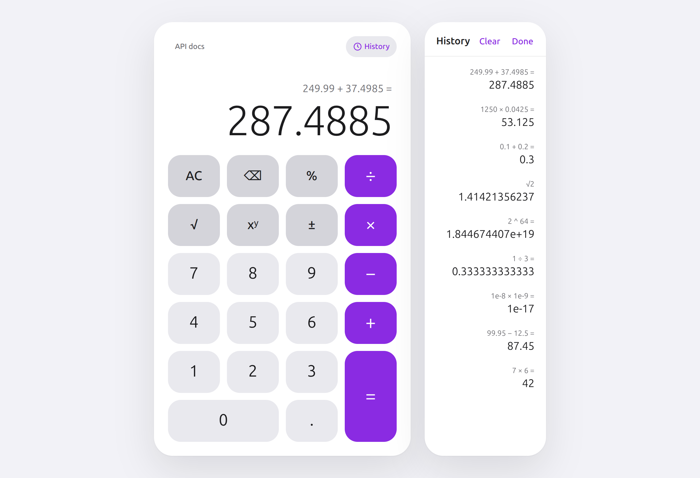
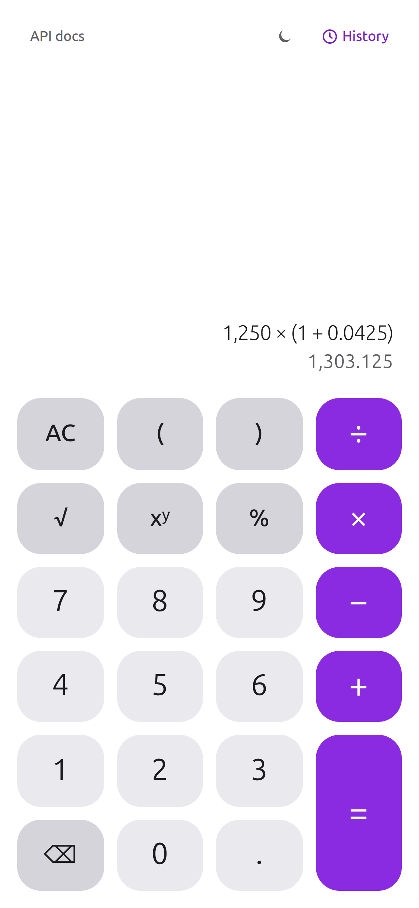

# Sezzle Calculator

A decimal-exact calculator: a React + TypeScript frontend on a Go REST API. `0.1 + 0.2` is `0.3`.

[](https://github.com/LuizColombo/sezzle-calculator/actions/workflows/ci.yml)

<p align="center">
  
  
</p>

## Quickstart

```bash
docker compose up --build
```

Open **http://localhost:8080**. The interactive API reference is at **http://localhost:8080/docs** (its viewer loads from a CDN; offline, the contract is at `/openapi.yaml`). If port 8080 is taken: `WEB_PORT=3000 docker compose up --build`.

### Without Docker

Requires Go 1.27+ and Node 22+.

```bash
cd api && go run ./cmd/api              # :8080
cd web && npm install && npm run dev   # :5173, proxies /api to :8080
```

Or `make dev`, which runs both. `make help` lists the other targets.

## What it does

- **Operations:** add, subtract, multiply, divide, power, square root, percentage — every required and optional one.
- **Decimal arithmetic** with 34 significant digits, never binary floats ([why](docs/adr/0002-decimal-arithmetic.md)).
- **A calculator that behaves like one:** chaining (`2 + 3 × 4` evaluates left to right), `200 + 15 %` = `230`, ± and √ on either operand, backspace, full keyboard support.
- **History** of the last 50 results, persisted locally; click one to reuse it.
- **Errors explained:** division by zero, out-of-range numbers and invalid input come back as RFC 9457 Problem Details and are shown in place. Network failures retry with exponential backoff, then offer a Retry.
- **Light and dark** themes, motion that respects reduced-motion settings, screen-reader labels, and a phone layout.

## API in three calls

```bash
curl -s -X POST localhost:8080/api/v1/add -H 'Content-Type: application/json' -d '{"a":"0.1","b":"0.2"}'
# {"operation":"add","inputs":{"a":"0.1","b":"0.2"},"result":"0.3"}

curl -s -X POST localhost:8080/api/v1/sqrt -H 'Content-Type: application/json' -d '{"value":"2"}'
# {"operation":"sqrt","inputs":{"value":"2"},"result":"1.414213562373095"}

curl -s -X POST localhost:8080/api/v1/divide -H 'Content-Type: application/json' -d '{"a":"1","b":"0"}'
# {"type":"…/docs/api.md#division-by-zero","title":"Division by zero","status":422,"detail":"division by zero","instance":"/api/v1/divide","requestId":"…"}
```

Numbers are JSON **strings** so no precision is lost on the wire. Every endpoint, field, limit and error type is in [docs/api.md](docs/api.md) and the [OpenAPI spec](api/openapi.yaml).

## Design decisions

| Decision | Why | |
|---|---|---|
| Decimal arithmetic (`cockroachdb/apd`), not `float64` | For a payments company, `0.30000000000000004` is a bug. | [ADR 2](docs/adr/0002-decimal-arithmetic.md) |
| Numbers as JSON strings | A JSON number becomes a float before your code sees it. | [ADR 3](docs/adr/0003-numbers-as-json-strings.md) |
| RFC 9457 Problem Details | One machine-readable error shape for every failure. | [ADR 4](docs/adr/0004-problem-details-errors.md) |
| Go standard library router | Go 1.22 covers method routing; gorilla/mux would be a one-line swap. | [ADR 1](docs/adr/0001-stdlib-router.md) |
| Two layered packages, not clean architecture | Interfaces with a single implementation add indirection, not testability. | [ADR 5](docs/adr/0005-layered-not-clean-architecture.md) |
| OpenAPI as the source of truth | Frontend types are generated from it; CI fails on drift. | [frontend.md](docs/frontend.md#talking-to-the-api) |
| A pure state machine for the calculator | All behaviour is testable without React or a network. | [frontend.md](docs/frontend.md#the-state-machine) |
| CSS Modules on design tokens | A small bespoke design system reads best as one token sheet. | [ADR 6](docs/adr/0006-css-modules-over-tailwind.md) |

**Assumptions.** Operations are evaluated as typed, left to right, like a basic calculator; operator precedence (`2 + 3 × 4 = 14`) is planned as a separate phase with its own endpoint. Results are rounded to 16 decimal places (tiny non-zero results switch to exponent notation rather than showing `0`). History is per browser; there is no server-side state or authentication.

## Tests

| | Command | |
|---|---|---|
| Go unit + HTTP | `cd api && go test -race -cover ./...` | 91 % domain, 99 % HTTP |
| Go fuzzing | `cd api && make fuzz` | found two real bugs |
| Frontend | `cd web && npm run test:coverage` | 95 % statements |
| End to end | `docker compose up -d --wait && cd web && npm run e2e` | desktop and phone |

CI runs all of it on every push, including lint, type checks and a check that generated API types match the contract. Coverage reports are attached to each run. Details: [docs/testing.md](docs/testing.md).

## How AI was used

Built with Claude Code: design spec and plan first, then test-driven implementation, with an independent AI reviewer at four checkpoints. The prompts, the process and every correction — including the AI's own mistakes — are in [docs/ai/](docs/ai/README.md).

## Documentation

[docs/](docs/README.md) — API usage, backend and frontend guides, testing, deployment, architecture decision records, the design spec and the implementation plan.
